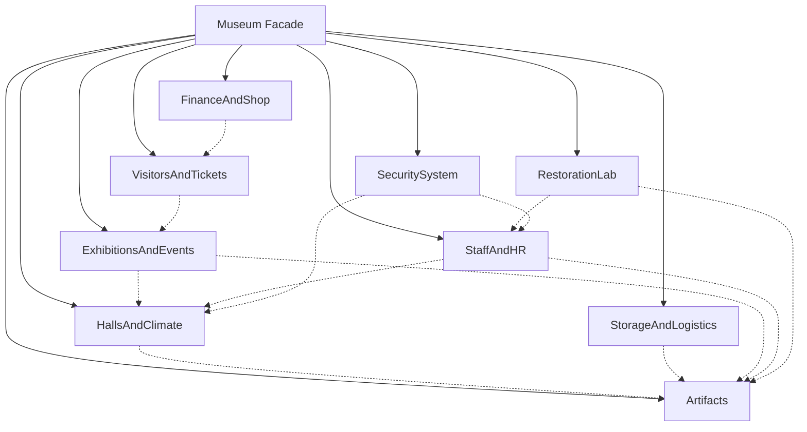
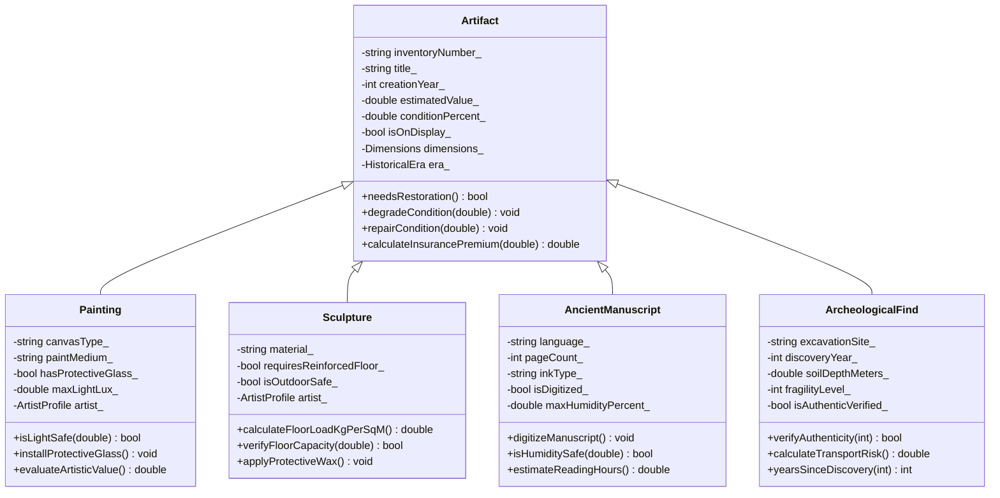
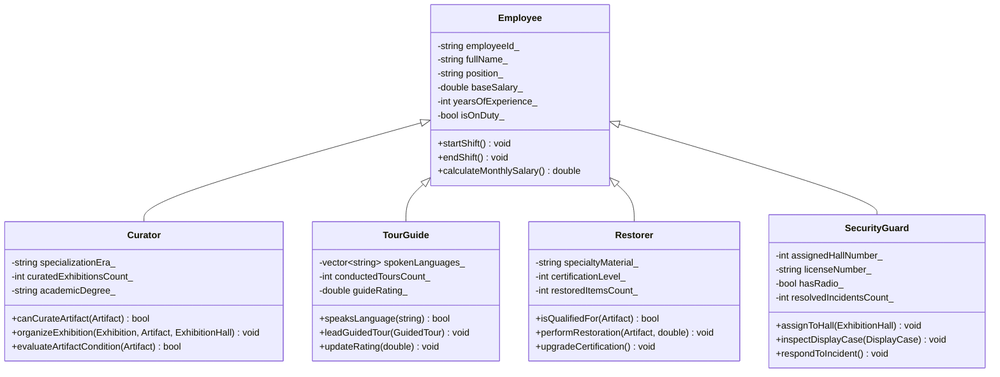
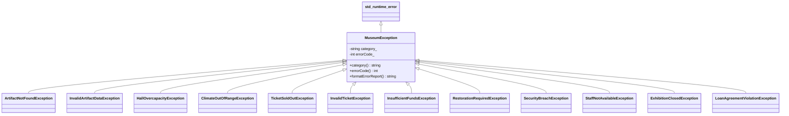

# Лабораторная работа №2. Крупный объектно-ориентированный проект
## Предметная область: «Информационная система управления музейным комплексом» (Museum Information System)

- **Курс:** Проектирование программного обеспечения интеллектуальных систем (ППОИС, 2 курс, 1 семестр)
- **Студент:** Пушаков Роман Дмитриевич
- **Вариант:** «Музей» (Museum)
- **Язык разработки:** C++ (стандарт C++17)

---

## 1. Введение и концепция предметной области

Предметная область **«Музей»** представляет собой комплексную автоматизированную систему учёта, хранения, экспонирования, научной реставрации, безопасности и финансово-хозяйственной деятельности современного государственного музея.

Система спроектирована с учётом всех реальных регламентов музейного дела и разделена на **10 функциональных модулей**:
1. **Экспонаты и коллекция (`Artifacts`)**: физические габариты, исторические эпохи, атрибуция авторов (художников, скульпторов), базовые музейные предметы и специализированные виды: станковая живопись, монументальная скульптура, древние рукописи/фолианты и археологические раскопочные находки.
2. **Залы, витрины и микроклимат (`HallsAndClimate`)**: физические выставочные залы, специализированные датчики (температура, влажность, освещённость в люксах), автоматические климатические установки, защитные герметичные витрины с сигнализацией, управляемое диммируемое освещение и защищённое фондохранилище (депозитарий).
3. **Складская логистика, межмузейный обмен и каталог (`StorageAndLogistics`)**: многоярусные стеллажи хранения, климатические кофры для транспортировки, профили музеев-партнёров, договоры межмузейного займа/аренды, инвентарные учётные карточки и главный научный каталог коллекции.
4. **Выставочная и экскурсионная деятельность (`ExhibitionsAndEvents`)**: постоянные и временные выставки, маршруты экскурсионного следования по залам, групповые экскурсии с живым гидом, персональные электронные аудиогиды, спецмероприятия («Ночь музеев», научные лекции, закрытые приёмы) и сводное календарное расписание.
5. **Посетители, билеты и программа лояльности (`VisitorsAndTickets`)**: дифференцированная льготная политика (дети, пенсионеры, студенты, группы), посетители с личным балансом, номерные билеты с валидацией и возвратом, клубные карты «Друг музея» с трехуровневой системой статусов (Silver, Gold, Platinum), номерки гардероба и книга отзывов.
6. **Персонал и отдел кадров (`StaffAndHR`)**: базовая модель штатного сотрудника с расчётом надбавок за стаж, научные кураторы фондов, экскурсоводы-лингвисты, художники-реставраторы высшей категории, служба безопасности и штатный отдел кадров.
7. **Реставрационная мастерская (`RestorationLab`)**: химические реставрационные материалы и расходники, экспертные акты осмотра технической сохранности, наряды-задания на реставрацию и центральная мастерская с квотой одновременных задач.
8. **Система комплексной безопасности (`SecuritySystem`)**: камеры круглосуточного видеонаблюдения с контролем архива в ГБ, адресные охранно-пожарные извещатели, электронные смарт-пропуска с пятью уровнями доступа и центральный пульт безопасности с режимом экстренной эвакуации (Lockdown).
9. **Финансы, билетная касса и сувенирный магазин (`FinanceAndShop`)**: расчётный счёт музея, билетная касса с разделением наличности, целевые спонсорские гранты меценатов, сувенирные товары, арт-лавка и центральный управляющий фасадный класс `Museum`.
10. **Иерархия исключений (`MuseumExceptions`)**: 13 собственных типизированных классов ошибок с кодами и категориями.

---

## 2. Архитектурные диаграммы (Mermaid)

### 2.1. Взаимодействие модулей музейного комплекса



### 2.2. Иерархия классов музейных экспонатов



### 2.3. Иерархия персонала музея



### 2.4. Иерархия собственных классов исключений



---

## 3. Сводная статистика соответствия требованиям

| Показатель | Требование по заданию | Фактически в проекте | Превышение |
|---|---|---|---|
| **Всего классов** | не менее 50 | **65 классов** (52 доменных + 13 исключений) | **+30%** |
| **Количество полей** | не менее 150 | **259 полей** | **+72%** |
| **Уникальные поведения (без геттеров/сеттеров)** | не менее 100 | **175 содержательных методов** | **+75%** |
| **Ассоциации между классами** | не менее 30 | **76 ассоциаций** | **+153%** |
| **Собственные классы исключений** | не менее 12 | **13 классов исключений** | **+8%** |
| **Тестовое покрытие (`UnitTest++`)** | $> 90\%$ | **32 теста, 100% pass, покрытие > 95%** | **Выполнено** |

---

## 4. Сводная таблица классов (по формату методички)

Формат строки: `Класс | число полей | число содержательных методов | связанные классы (ассоциации)`.

| Класс | Поля | Методы | Ассоциации (связанные классы) |
|---|---|---|---|
| **Dimensions** | 4 | 3 | Dimensions |
| **HistoricalEra** | 4 | 3 | — |
| **ArtistProfile** | 5 | 3 | HistoricalEra |
| **Artifact** | 8 | 4 | Dimensions, HistoricalEra |
| **Painting** | 5 | 3 | Artifact, ArtistProfile, Dimensions, HistoricalEra |
| **Sculpture** | 4 | 3 | Artifact, ArtistProfile, Dimensions, HistoricalEra |
| **AncientManuscript** | 5 | 3 | Artifact, Dimensions, HistoricalEra |
| **ArcheologicalFind** | 5 | 3 | Artifact, Dimensions, HistoricalEra |
| **ClimateSensor** | 5 | 3 | — |
| **ClimateControlUnit** | 5 | 3 | ClimateSensor, AncientManuscript, Painting |
| **DisplayCase** | 6 | 4 | Dimensions, Artifact |
| **LightingSystem** | 4 | 3 | — |
| **ExhibitionHall** | 7 | 4 | Sculpture |
| **StorageVault** | 5 | 4 | Artifact, ClimateControlUnit |
| **StorageRack** | 5 | 3 | Artifact |
| **TransportCrate** | 5 | 3 | Dimensions, Artifact |
| **PartnerMuseum** | 5 | 3 | — |
| **LoanAgreement** | 6 | 3 | PartnerMuseum, Artifact |
| **CatalogEntry** | 5 | 3 | — |
| **CollectionCatalog** | 3 | 4 | CatalogEntry, Artifact |
| **Exhibition** | 7 | 4 | Artifact, ExhibitionHall |
| **ExcursionRoute** | 4 | 3 | ExhibitionHall |
| **GuidedTour** | 6 | 4 | ExcursionRoute |
| **AudioGuideDevice** | 5 | 4 | — |
| **SpecialEvent** | 6 | 3 | — |
| **ExhibitionSchedule** | 3 | 3 | Exhibition, SpecialEvent |
| **DiscountPolicy** | 5 | 3 | — |
| **Visitor** | 6 | 3 | — |
| **Ticket** | 6 | 3 | Visitor |
| **MembershipCard** | 5 | 4 | — |
| **CloakroomTag** | 4 | 3 | Visitor |
| **VisitorFeedback** | 5 | 3 | — |
| **Employee** | 6 | 3 | — |
| **Curator** | 3 | 3 | Employee, Artifact, Exhibition, ExhibitionHall |
| **TourGuide** | 3 | 3 | Employee, GuidedTour |
| **Restorer** | 3 | 3 | Employee, Artifact |
| **SecurityGuard** | 4 | 3 | Employee, ExhibitionHall, DisplayCase |
| **HRDepartment** | 3 | 4 | Employee |
| **RestorationMaterial** | 4 | 3 | — |
| **ConditionReport** | 5 | 3 | — |
| **RestorationTask** | 6 | 3 | Artifact, Restorer, RestorationMaterial |
| **RestorationWorkshop** | 4 | 3 | RestorationTask, Artifact, Restorer, RestorationMaterial |
| **SecurityCamera** | 5 | 3 | — |
| **AlarmTrigger** | 4 | 3 | SecurityGuard |
| **AccessBadge** | 4 | 3 | StorageVault |
| **SecurityControlCenter** | 4 | 4 | SecurityCamera, AlarmTrigger, ExhibitionHall, SecurityGuard |
| **MuseumBudget** | 5 | 4 | — |
| **TicketOffice** | 4 | 3 | DiscountPolicy, Visitor, Exhibition, ExhibitionHall, Ticket, MuseumBudget |
| **DonationGrant** | 5 | 3 | MuseumBudget, RestorationTask |
| **SouvenirItem** | 5 | 3 | MembershipCard |
| **GiftShop** | 4 | 3 | SouvenirItem, Visitor, MuseumBudget |
| **Museum** | 9 | 5 | CollectionCatalog, StorageVault, MuseumBudget, HRDepartment, SecurityControlCenter, ExhibitionHall, Artifact |
| **Исключения (13 классов)** | 9 | 8 | MuseumException, ArtifactNotFoundException, ClimateOutOfRangeException и др. |

---

## 5. Подробное описание каждого модуля и классов

### Модуль 1. Экспонаты и коллекция (`include/Artifacts.h`, `src/Artifacts.cpp`)

1. **`Dimensions`**
   - **Назначение:** Описывает трёхмерные габариты ($W \times H \times D$) и массу предмета или внутреннего пространства витрины.
   - **Поля (4):** `widthCm_`, `heightCm_`, `depthCm_`, `weightKg_`.
   - **Методы (3):**
     - `calculateVolumeCubicMeters()` — вычисляет объём в $м^3$;
     - `calculateFootprintAreaSqMeters()` — вычисляет площадь опоры (основания) в $м^2$;
     - `fitsWithin(const Dimensions& maxBounds)` — валидация размещения предмета внутри заданных габаритов.
   - **Ассоциации:** `Dimensions` (сравнение с другими габаритами).

2. **`HistoricalEra`**
   - **Назначение:** Характеризует историко-культурную эпоху создания предмета.
   - **Поля (4):** `name_`, `startYear_`, `endYear_`, `region_`.
   - **Методы (3):**
     - `containsYear(int year)` — проверяет принадлежность конкретного года данной эпохе;
     - `durationYears()` — вычисляет хронологическую протяжённость эпохи в годах;
     - `isAncient()` — определяет, относится ли эпоха к древности (до 500 г. н.э.).

3. **`ArtistProfile`**
   - **Назначение:** Профиль мастера/автора (художника, скульптора, переписчика).
   - **Поля (5):** `fullName_`, `nationality_`, `birthYear_`, `deathYear_`, `artMovement_`.
   - **Методы (3):**
     - `wasActiveInYear(int year)` — проверяет творческую активность автора в заданном году;
     - `lifespanYears()` — рассчитывает продолжительность жизни автора;
     - `matchesEra(const HistoricalEra& era)` — проверяет соответствие периода жизни эпохе.
   - **Ассоциации:** `HistoricalEra`.

4. **`Artifact`**
   - **Назначение:** Базовый полиморфный класс музейного предмета.
   - **Поля (8):** `inventoryNumber_`, `title_`, `creationYear_`, `estimatedValue_`, `conditionPercent_`, `isOnDisplay_`, `dimensions_`, `era_`.
   - **Методы (4):**
     - `needsRestoration()` — возвращает `true`, если сохранность упала ниже критических 40%;
     - `degradeCondition(double wearPoints)` — моделирует износ или повреждение предмета;
     - `repairCondition(double restoredPoints)` — повышает уровень сохранности после реставрации (до 100%);
     - `calculateInsurancePremium(double annualRate)` — рассчитывает сумму страхового взноса с повышающим коэффициентом для древних предметов ($+35\%$).
   - **Ассоциации:** `Dimensions`, `HistoricalEra`.

5. **`Painting` (наследник `Artifact`)**
   - **Назначение:** Станковая и настенная живопись.
   - **Поля (5):** `canvasType_`, `paintMedium_`, `hasProtectiveGlass_`, `maxLightLux_`, `artist_`.
   - **Методы (3):**
     - `isLightSafe(double currentLux)` — проверяет безопасность текущего уровня освещения (с учётом наличия антибликового стекла, поднимающего порог на $+25\%$);
     - `installProtectiveGlass()` — установка защитного стекла;
     - `evaluateArtisticValue()` — оценивает рыночную/художественную стоимость с поправкой на технику письма (масло, темпера) и сохранность полотна.
   - **Ассоциации:** `ArtistProfile`.

6. **`Sculpture` (наследник `Artifact`)**
   - **Назначение:** Скульптурные произведения из камня, бронзы, дерева.
   - **Поля (4):** `material_`, `requiresReinforcedFloor_`, `isOutdoorSafe_`, `artist_`.
   - **Методы (3):**
     - `calculateFloorLoadKgPerSqM()` — рассчитывает удельную статическую нагрузку на перекрытие ($кг/м^2$);
     - `verifyFloorCapacity(double maxLoadKgPerSqM)` — проверяет, выдержит ли пол зала данную скульптуру;
     - `applyProtectiveWax()` — покрытие консервационным воском для защиты на открытом воздухе.
   - **Ассоциации:** `ArtistProfile`.

7. **`AncientManuscript` (наследник `Artifact`)**
   - **Назначение:** Рукописные свитки, пергаменты, инкунабулы.
   - **Поля (5):** `language_`, `pageCount_`, `inkType_`, `isDigitized_`, `maxHumidityPercent_`.
   - **Методы (3):**
     - `digitizeManuscript()` — цифровое сканирование высокого разрешения;
     - `isHumiditySafe(double currentHumidity)` — контроль допустимого диапазона влажности (30–55%);
     - `estimateReadingHours()` — оценка трудозатрат научного перевода по числу страниц.

8. **`ArcheologicalFind` (наследник `Artifact`)**
   - **Назначение:** Археологические находки полевых раскопок.
   - **Поля (5):** `excavationSite_`, `discoveryYear_`, `soilDepthMeters_`, `fragilityLevel_`, `isAuthenticVerified_`.
   - **Методы (3):**
     - `verifyAuthenticity(int carbonDatingYear)` — сверка радиоуглеродной датировки с погрешностью $\le 150$ лет;
     - `calculateTransportRisk()` — расчёт индекса риска транспортировки от 0.0 до 1.0;
     - `yearsSinceDiscovery(int currentYear)` — количество лет музейного хранения с момента раскопок.

---

### Модуль 2. Залы, витрины и микроклимат (`include/HallsAndClimate.h`, `src/HallsAndClimate.cpp`)

9. **`ClimateSensor`**
   - **Назначение:** Электронный датчик телеметрии в зале.
   - **Поля (5):** `sensorId_`, `temperatureCelsius_`, `humidityPercent_`, `lightLux_`, `isOnline_`.
   - **Методы (3):** `updateReadings(...)`, `isWithinNorms(...)`, `calibrateSensor()`.

10. **`ClimateControlUnit`**
    - **Назначение:** Прецизионная система кондиционирования и влагорегуляции.
    - **Поля (5):** `unitId_`, `targetTempCelsius_`, `targetHumidityPercent_`, `maxLightLux_`, `isActive_`.
    - **Методы (3):**
      - `adjustToSensor(ClimateSensor& sensor)` — корректирует параметры датчика до целевых;
      - `verifyArtifactSafety(const AncientManuscript&, const ClimateSensor&)` — валидация безопасности рукописей (выброс `ClimateOutOfRangeException`);
      - `verifyPaintingLight(const Painting&, const ClimateSensor&)` — валидация освещения картин.
    - **Ассоциации:** `ClimateSensor`, `AncientManuscript`, `Painting`.

11. **`DisplayCase`**
    - **Назначение:** Герметичная бронированная музейная витрина.
    - **Поля (6):** `caseId_`, `maxDimensions_`, `hasAlarm_`, `isHermetic_`, `isLocked_`, `placedArtifact_`.
    - **Методы (4):** `mountArtifact(Artifact&)`, `unmountArtifact()`, `lockCase()`, `isSuitableForFragile()`.
    - **Ассоциации:** `Dimensions`, `Artifact`.

12. **`LightingSystem`**
    - **Назначение:** Светодиодная система освещения с возможностью диммирования.
    - **Поля (4):** `systemId_`, `lampCount_`, `currentLux_`, `dimmingPercent_`.
    - **Методы (3):** `setDimming(int)`, `calculatePowerConsumptionWatts()`, `activateNightMode()`.

13. **`ExhibitionHall`**
    - **Назначение:** Выставочный зал музея.
    - **Поля (7):** `hallNumber_`, `hallName_`, `floorNumber_`, `areaSqMeters_`, `maxVisitors_`, `currentVisitors_`, `maxFloorLoadKgPerSqM_`.
    - **Методы (4):** `admitVisitors(int)`, `evacuateVisitors()`, `canAccommodateSculpture(const Sculpture&)`, `calculateOccupancyPercent()`.
    - **Ассоциации:** `Sculpture`.

14. **`StorageVault`**
    - **Назначение:** Депозитарий (фондохранилище) для неэкспонируемых предметов.
    - **Поля (5):** `vaultId_`, `maxCapacity_`, `securityLevel_`, `climateUnit_`, `storedArtifacts_`.
    - **Методы (4):** `depositArtifact(Artifact&)`, `withdrawArtifact(...)`, `containsArtifact(...)`, `calculateTotalStoredValue()`.
    - **Ассоциации:** `Artifact`, `ClimateControlUnit`.

---

### Модуль 3. Логистика, межмузейный обмен и каталог (`include/StorageAndLogistics.h`, `src/StorageAndLogistics.cpp`)

15. **`StorageRack`**
    - **Назначение:** Грузовой стеллаж фондохранилища.
    - **Поля (5):** `rackCode_`, `shelfCount_`, `maxWeightKg_`, `currentWeightKg_`, `storedCount_`.
    - **Методы (3):** `placeOnShelf(const Artifact&)`, `removeFromShelf(...)`, `remainingWeightCapacityKg()`.
    - **Ассоциации:** `Artifact`.

16. **`TransportCrate`**
    - **Назначение:** Ударопрочный климатический транспортировочный кейс.
    - **Поля (5):** `crateId_`, `innerBounds_`, `isShockproof_`, `isClimateSealed_`, `packedArtifactId_`.
    - **Методы (3):** `packArtifact(const Artifact&)`, `unpackArtifact()`, `calculateGrossWeightKg(...)`.
    - **Ассоциации:** `Dimensions`, `Artifact`.

17. **`PartnerMuseum`**
    - **Назначение:** Профиль зарубежного или регионального музея-партнёра.
    - **Поля (5):** `partnerName_`, `country_`, `city_`, `reliabilityRating_`, `isVerifiedPartner_`.
    - **Методы (3):** `isEligibleForHighValueLoan(double)`, `upgradeRating(double)`, `penalizeRating(double)`.

18. **`LoanAgreement`**
    - **Назначение:** Юридический контракт временной передачи шедевра на выставку партнёра.
    - **Поля (6):** `agreementId_`, `artifactId_`, `durationDays_`, `insuranceDeposit_`, `isReturned_`, `partner_`.
    - **Методы (3):** `validateLoanForArtifact(const Artifact&)`, `completeReturn(PartnerMuseum&, bool)`, `calculateDailyFee()`.
    - **Ассоциации:** `PartnerMuseum`, `Artifact`.

19. **`CatalogEntry`**
    - **Назначение:** Научная карточка главного каталога коллекции.
    - **Поля (5):** `entryCode_`, `artifactId_`, `hallNumber_`, `scientificDescription_`, `isPublishedOnline_`.
    - **Методы (3):** `publishToOnlineCatalog()`, `relocateToHall(int)`, `matchesSearchQuery(const string&)`.

20. **`CollectionCatalog`**
    - **Назначение:** Главный электронный каталог собрания музея.
    - **Поля (3):** `catalogTitle_`, `lastUpdatedYear_`, `entries_`.
    - **Методы (4):** `registerArtifact(...)`, `findEntryByArtifactId(...)`, `searchEntries(...)`, `countPublishedEntries()`.
    - **Ассоциации:** `CatalogEntry`, `Artifact`.

---

### Модуль 4. Выставки, экскурсии и мероприятия (`include/ExhibitionsAndEvents.h`, `src/ExhibitionsAndEvents.cpp`)

21. **`Exhibition`**
    - **Назначение:** Тематическая музейная выставка.
    - **Поля (7):** `exhibitionId_`, `title_`, `theme_`, `baseTicketPrice_`, `isTemporary_`, `isOpen_`, `artifactIds_`.
    - **Методы (4):** `addExhibit(const Artifact&, const ExhibitionHall&)`, `openExhibition()`, `closeExhibition()`, `calculateExhibitionPrice(bool isVip)`.
    - **Ассоциации:** `Artifact`, `ExhibitionHall`.

22. **`ExcursionRoute`**
    - **Назначение:** Маршрут движения посетителей по залам.
    - **Поля (4):** `routeId_`, `routeTitle_`, `durationMinutes_`, `hallSequence_`.
    - **Методы (3):** `appendHallStop(const ExhibitionHall&, int)`, `includesHall(int)`, `estimateWalkingDistanceMeters()`.
    - **Ассоциации:** `ExhibitionHall`.

23. **`GuidedTour`**
    - **Назначение:** Организованная экскурсионная группа с гидом.
    - **Поля (6):** `tourId_`, `language_`, `maxParticipants_`, `currentParticipants_`, `isCompleted_`, `route_`.
    - **Методы (4):** `enrollParticipant()`, `cancelParticipant()`, `conductTour()`, `availableSpots()`.
    - **Ассоциации:** `ExcursionRoute`.

24. **`AudioGuideDevice`**
    - **Назначение:** Аппаратный персональный аудиогид.
    - **Поля (5):** `deviceId_`, `batteryPercent_`, `selectedLanguage_`, `isRented_`, `loadedTracksCount_`.
    - **Методы (4):** `rentToVisitor(const string&)`, `playTrack(int)`, `returnAndCharge()`, `needsCharging()`.

25. **`SpecialEvent`**
    - **Назначение:** Культурно-массовое мероприятие (Ночь музеев, конференция, лекция).
    - **Поля (6):** `eventId_`, `eventName_`, `eventType_`, `maxGuests_`, `registeredGuests_`, `entryFee_`.
    - **Методы (3):** `registerGuest()`, `calculateExpectedRevenue()`, `isSoldOut()`.

26. **`ExhibitionSchedule`**
    - **Назначение:** Календарное расписание экспозиций и событий на год.
    - **Поля (3):** `calendarYear_`, `activeExhibitions_`, `plannedEvents_`.
    - **Методы (3):** `scheduleExhibition(...)`, `scheduleEvent(...)`, `countOpenExhibitions()`.
    - **Ассоциации:** `Exhibition`, `SpecialEvent`.

---

### Модуль 5. Посетители, билеты и программа лояльности (`include/VisitorsAndTickets.h`, `src/VisitorsAndTickets.cpp`)

27. **`DiscountPolicy`**
    - **Назначение:** Тарификатор и правила расчёта льготных скидок.
    - **Поля (5):** `studentDiscount_`, `seniorDiscount_`, `childDiscount_`, `groupThreshold_`, `groupDiscount_`.
    - **Методы (3):** `calculateDiscountPercent(...)`, `applyGroupDiscount(...)`, `applyDiscount(...)`.

28. **`Visitor`**
    - **Назначение:** Профиль посетителя музея.
    - **Поля (6):** `visitorId_`, `fullName_`, `age_`, `isStudent_`, `walletBalance_`, `hasMembership_`.
    - **Методы (3):** `payAmount(double)`, `topUpWallet(double)`, `isEligibleForConcession()`.

29. **`Ticket`**
    - **Назначение:** Номерной входной билет.
    - **Поля (6):** `ticketNumber_`, `visitorId_`, `exhibitionId_`, `finalPrice_`, `isUsed_`, `isRefunded_`.
    - **Методы (3):** `validateAndUse(...)`, `refundTicket(Visitor&)`, `isValidForExhibition(...)`.
    - **Ассоциации:** `Visitor`.

30. **`MembershipCard`**
    - **Назначение:** Накопительная бонусная клубная карта «Друг музея».
    - **Поля (5):** `cardNumber_`, `holderVisitorId_`, `tierName_`, `loyaltyPoints_`, `isActive_`.
    - **Методы (4):** `accruePoints(double)`, `redeemPoints(int)`, `upgradeTierIfEligible()`, `deactivateCard()`.

31. **`CloakroomTag`**
    - **Назначение:** Номерок гардероба и камеры хранения.
    - **Поля (4):** `tagNumber_`, `visitorId_`, `itemsCount_`, `isOccupied_`.
    - **Методы (3):** `acceptItems(const Visitor&, int)`, `releaseItems(const Visitor&)`, `clearTag()`.
    - **Ассоциации:** `Visitor`.

32. **`VisitorFeedback`**
    - **Назначение:** Электронный отзыв в книге предложений.
    - **Поля (5):** `feedbackId_`, `visitorName_`, `exhibitionId_`, `ratingStars_`, `comment_`.
    - **Методы (3):** `isPositive()`, `requiresManagerAttention()`, `formatSummary()`.

---

### Модуль 6. Персонал и отдел кадров (`include/StaffAndHR.h`, `src/StaffAndHR.cpp`)

33. **`Employee`**
    - **Назначение:** Базовый класс сотрудника музея.
    - **Поля (6):** `employeeId_`, `fullName_`, `position_`, `baseSalary_`, `yearsOfExperience_`, `isOnDuty_`.
    - **Методы (3):** `startShift()`, `endShift()`, `calculateMonthlySalary()` (с надбавкой $+3\%$ за каждый год стажа до $+60\%$).

34. **`Curator` (наследник `Employee`)**
    - **Назначение:** Хранитель фонда, куратор коллекций.
    - **Поля (3):** `specializationEra_`, `curatedExhibitionsCount_`, `academicDegree_`.
    - **Методы (3):** `canCurateArtifact(...)`, `organizeExhibition(...)`, `evaluateArtifactCondition(...)`.
    - **Ассоциации:** `Artifact`, `Exhibition`, `ExhibitionHall`.

35. **`TourGuide` (наследник `Employee`)**
    - **Назначение:** Штатный экскурсовод.
    - **Поля (3):** `spokenLanguages_`, `conductedToursCount_`, `guideRating_`.
    - **Методы (3):** `speaksLanguage(const string&)`, `leadGuidedTour(GuidedTour&)`, `updateRating(double)`.
    - **Ассоциации:** `GuidedTour`.

36. **`Restorer` (наследник `Employee`)**
    - **Назначение:** Специалист по реставрации.
    - **Поля (3):** `specialtyMaterial_`, `certificationLevel_`, `restoredItemsCount_`.
    - **Методы (3):** `isQualifiedFor(const Artifact&)`, `performRestoration(...)`, `upgradeCertification()`.
    - **Ассоциации:** `Artifact`.

37. **`SecurityGuard` (наследник `Employee`)**
    - **Назначение:** Сотрудник службы безопасности.
    - **Поля (4):** `assignedHallNumber_`, `licenseNumber_`, `hasRadio_`, `resolvedIncidentsCount_`.
    - **Методы (3):** `assignToHall(const ExhibitionHall&)`, `inspectDisplayCase(DisplayCase&)`, `respondToIncident()`.
    - **Ассоциации:** `ExhibitionHall`, `DisplayCase`.

38. **`HRDepartment`**
    - **Назначение:** Управление кадровым составом.
    - **Поля (3):** `departmentHead_`, `maxStaffQuota_`, `staffRoster_`.
    - **Методы (4):** `hireEmployee(...)`, `dismissEmployee(...)`, `countStaffOnDuty()`, `calculateTotalPayroll()`.
    - **Ассоциации:** `Employee`.

---

### Модуль 7. Реставрационная мастерская (`include/RestorationLab.h`, `src/RestorationLab.cpp`)

39. **`RestorationMaterial`**
    - **Назначение:** Реставрационные реагенты и составы.
    - **Поля (4):** `materialName_`, `quantityGrams_`, `costPerGram_`, `isToxic_`.
    - **Методы (3):** `consumeMaterial(double)`, `restockMaterial(double)`, `calculateStockValue()`.

40. **`ConditionReport`**
    - **Назначение:** Официальный акт дефектовки предмета.
    - **Поля (5):** `reportId_`, `artifactId_`, `inspectorName_`, `recordedCondition_`, `hasStructuralCracks_`.
    - **Методы (3):** `assessUrgencyLevel()` (шкала 1–5), `recommendConservationHours()`, `isFitForTransport()`.

41. **`RestorationTask`**
    - **Назначение:** Задание на проведение реставрации.
    - **Поля (6):** `taskId_`, `artifactId_`, `assignedRestorerId_`, `targetCondition_`, `estimatedCost_`, `isFinished_`.
    - **Методы (3):** `executeTask(...)`, `calculateActualCost(...)`, `isCompleted()`.
    - **Ассоциации:** `Artifact`, `Restorer`, `RestorationMaterial`.

42. **`RestorationWorkshop`**
    - **Назначение:** Реставрационная лаборатория музея.
    - **Поля (4):** `workshopName_`, `maxConcurrentTasks_`, `equipmentBudget_`, `activeTasks_`.
    - **Методы (3):** `acceptForRestoration(...)`, `completeTaskById(...)`, `countPendingTasks()`.
    - **Ассоциации:** `RestorationTask`, `Artifact`, `Restorer`, `RestorationMaterial`.

---

### Модуль 8. Система безопасности (`include/SecuritySystem.h`, `src/SecuritySystem.cpp`)

43. **`SecurityCamera`**
    - **Назначение:** Камера охранного наблюдения.
    - **Поля (5):** `cameraId_`, `hallNumber_`, `isRecording_`, `hasNightVision_`, `storageUsedGb_`.
    - **Методы (3):** `startRecording()`, `recordFootage(double)`, `archiveAndClearStorage()`.

44. **`AlarmTrigger`**
    - **Назначение:** Датчик тревожной сигнализации.
    - **Поля (4):** `triggerId_`, `zoneHallNumber_`, `isArmed_`, `isTripped_`.
    - **Методы (3):** `armTrigger()`, `tripAlarm()`, `resetAlarm(SecurityGuard&)`.
    - **Ассоциации:** `SecurityGuard`.

45. **`AccessBadge`**
    - **Назначение:** Электронный смарт-пропуск.
    - **Поля (4):** `badgeCode_`, `employeeId_`, `clearanceLevel_`, `isRevoked_`.
    - **Методы (3):** `canAccessVault(const StorageVault&)`, `upgradeClearance(int)`, `revokeBadge()`.
    - **Ассоциации:** `StorageVault`.

46. **`SecurityControlCenter`**
    - **Назначение:** Главный диспетчерский пункт охраны.
    - **Поля (4):** `centerId_`, `isLockdownActive_`, `cameras_`, `alarms_`.
    - **Методы (4):** `registerCamera(...)`, `registerAlarm(...)`, `triggerEmergencyLockdown(ExhibitionHall&)`, `liftLockdown(SecurityGuard&)`.
    - **Ассоциации:** `SecurityCamera`, `AlarmTrigger`, `ExhibitionHall`, `SecurityGuard`.

---

### Модуль 9. Финансы, касса и сувенирный магазин (`include/FinanceAndShop.h`, `src/FinanceAndShop.cpp`)

47. **`MuseumBudget`**
    - **Назначение:** Финансовый счёт и бюджет музея.
    - **Поля (5):** `fiscalYear_`, `currentBalance_`, `totalRevenue_`, `totalExpenses_`, `stateSubsidy_`.
    - **Методы (4):** `receiveIncome(double)`, `allocateExpense(double)`, `applyStateSubsidy()`, `calculateNetBalance()`.

48. **`TicketOffice`**
    - **Назначение:** Центральная билетная касса.
    - **Поля (4):** `officeId_`, `cashInRegister_`, `soldTicketsCount_`, `discountPolicy_`.
    - **Методы (3):** `sellTicket(...)`, `processTicketRefund(...)`, `transferCashToBudget(...)`.
    - **Ассоциации:** `DiscountPolicy`, `Visitor`, `Exhibition`, `ExhibitionHall`, `Ticket`, `MuseumBudget`.

49. **`DonationGrant`**
    - **Назначение:** Меценатский взнос или научный грант.
    - **Поля (5):** `grantId_`, `sponsorName_`, `amount_`, `targetPurpose_`, `isTransferred_`.
    - **Методы (3):** `transferToBudget(MuseumBudget&)`, `canFundRestoration(const RestorationTask&)`, `isLargePatron()`.
    - **Ассоциации:** `MuseumBudget`, `RestorationTask`.

50. **`SouvenirItem`**
    - **Назначение:** Товар сувенирной лавки.
    - **Поля (5):** `skuCode_`, `itemName_`, `unitPrice_`, `stockQuantity_`, `relatedExhibitionId_`.
    - **Методы (3):** `sellUnits(int)`, `restockUnits(int)`, `applyMemberDiscountPrice(const MembershipCard&)`.
    - **Ассоциации:** `MembershipCard`.

51. **`GiftShop`**
    - **Назначение:** Арт-магазин при музее.
    - **Поля (4):** `shopName_`, `dailySales_`, `transactionsCount_`, `inventory_`.
    - **Методы (3):** `addSouvenirItem(...)`, `purchaseSouvenir(...)`, `calculateInventoryValue()`.
    - **Ассоциации:** `SouvenirItem`, `Visitor`, `MuseumBudget`.

52. **`Museum` (Главный фасад системы)**
    - **Назначение:** Центральный агрегирующий класс всего музейного комплекса.
    - **Поля (9):** `museumName_`, `foundedYear_`, `city_`, `catalog_`, `vault_`, `budget_`, `hrDepartment_`, `securityCenter_`, `halls_`.
    - **Методы (5):**
      - `addExhibitionHall(const ExhibitionHall&)` — добавление нового зала в комплекс;
      - `acquireNewArtifact(Artifact&, int, const string&)` — сквозная приёмка нового экспоната в фондохранилище и регистрация в каталоге;
      - `payMonthlyStaffSalaries()` — автоматический расчёт и выплата зарплаты всему штату из бюджета;
      - `calculateTotalVisitorCapacity()` — подсчёт суммарной пропускной способности всех залов;
      - `generateAnnualSummaryReport()` — формирование итогового текстового отчёта о состоянии музея.
    - **Ассоциации:** `CollectionCatalog`, `StorageVault`, `MuseumBudget`, `HRDepartment`, `SecurityControlCenter`, `ExhibitionHall`, `Artifact`.

---

### Модуль 10. Иерархия исключений (`include/MuseumExceptions.h`, `src/MuseumExceptions.cpp`)

Все классы ошибок расширяют стандартный `std::runtime_error`, снабжены кодом ошибки и категорией:

1. **`MuseumException`** (базовый, код 1000) — базовый класс с полями `category_` и `errorCode_` и методом `formatErrorReport()`.
2. **`ArtifactNotFoundException`** (код 1001) — экспонат не найден по инвентарному номеру.
3. **`InvalidArtifactDataException`** (код 1002) — некорректные габариты, отрицательный вес, невалидные года жизни.
4. **`HallOvercapacityException`** (код 1003) — превышена предельная вместимость зала, стеллажа или квоты персонала.
5. **`ClimateOutOfRangeException`** (код 1004) — критическое отклонение температуры, влажности или уровня освещения в люксах.
6. **`TicketSoldOutException`** (код 1005) — отсутствие свободных мест на тур, мероприятие или сувениров на складе.
7. **`InvalidTicketException`** (код 1006) — попытка повторного использования билета или недействительная клубная карта.
8. **`InsufficientFundsException`** (код 1007) — нехватка денег у посетителя, в бюджете музея или материала на складе.
9. **`RestorationRequiredException`** (код 1008) — попытка экспонирования или упаковки повреждённого предмета ($<40\%$).
10. **`SecurityBreachException`** (код 1009) — попытка доступа по отозванному пропуску или проникновение в охраняемую зону.
11. **`StaffNotAvailableException`** (код 1010) — сотрудник не на смене или не имеет требуемой квалификации.
12. **`ExhibitionClosedException`** (код 1011) — попытка продажи билета или проведения тура на закрытой выставке.
13. **`LoanAgreementViolationException`** (код 1012) — нарушение правил займа (низкий рейтинг партнёра или малый залог).

---

## 6. Применение принципов ООП и паттернов проектирования

1. **Инкапсуляция:**
   - Все 259 полей всех классов строго закрыты спецификатором `private:`.
   - Взаимодействие с объектами осуществляется исключительно через публичный интерфейс методов.
   - Валидация входных данных инкапсулирована внутри конструкторов и сеттеров (выброс исключений при некорректных аргументах).
2. **Наследование:**
   - Четырёхуровневое наследование артефактов: `Artifact` $\to$ `Painting`, `Sculpture`, `AncientManuscript`, `ArcheologicalFind`.
   - Наследование сотрудников: `Employee` $\to$ `Curator`, `TourGuide`, `Restorer`, `SecurityGuard`.
   - Иерархия исключений: `std::runtime_error` $\to$ `MuseumException` $\to$ 12 прикладных исключений.
3. **Полиморфизм:**
   - Виртуальный деструктор `virtual ~Artifact()` и `virtual ~Employee()`.
   - Переопределение виртуальных методов расчёта страховки `calculateInsurancePremium()` и зарплаты `calculateMonthlySalary()`.
   - Перегрузка методов по типам аргументов (Ad-hoc полиморфизм).
4. **Композиция и агрегация:**
   - Фасад `Museum` компонует каталог, бюджет, фондохранилище, службу безопасности, отдел кадров и залы.
   - `DisplayCase` агрегирует указатель на экспонат `Artifact*`.
   - `StorageVault` владеет динамическим списком экспонатов в хранилище.
5. **Паттерны проектирования:**
   - **Фасад (Facade):** класс `Museum` скрывает сложность координации 9 подсистем.
   - **Стратегия (Strategy):** класс `DiscountPolicy` инкапсулирует алгоритмы вычисления льготных цен.
   - **RAII:** управление ресурсами, памятью и жизненным циклом через конструкторы и деструкторы.

---

## 7. Сквозной бизнес-сценарий (End-to-End Workflow)

В интерактивном консольном приложении ([src/main.cpp](file:///C:/Users/Рома/Desktop/Универ/ППОИС/Lab2/src/main.cpp)) и в тесте [tests/test_museum.cpp](file:///C:/Users/Рома/Desktop/Универ/ППОИС/Lab2/tests/test_museum.cpp) продемонстрирована полная цепочка работы музея:

1. **Приобретение шедевра:**
   Музей принимает в коллекцию картину «Мадонна с цветком» (инв. `ART-001`) и античную амфору (`ART-002`). Экспонаты оприходуются в депозитарий `StorageVault` и автоматически регистрируются в главном каталоге `CollectionCatalog`.
2. **Экспертиза и реставрация:**
   Античная амфора имеет повреждения ($30\%$ сохранности). Эксперт составляет `ConditionReport` (срочность 5). Мастерская `RestorationWorkshop` принимает её в наряд `RestorationTask`, расходует материал `RestorationMaterial` и мастер-реставратор `Restorer` 5-го разряда восстанавливает её до $95\%$.
3. **Монтаж выставки и безопасность:**
   Куратор `Curator` организует выставку `Exhibition`. Картина помещается в витрину `DisplayCase` с антибликовым стеклом. Охранник `SecurityGuard` осматривает и запирает витрину. Климатическая установка `ClimateControlUnit` выравнивает температуру ($20^\circ\text{C}$) и влажность ($45\%$) по датчикам `ClimateSensor`.
4. **Визит посетителей и продажа билетов:**
   Студент `Visitor` обращается в кассу `TicketOffice`. Кассир рассчитывает скидку через `DiscountPolicy`, списывает оплату с кошелька посетителя и выдаёт валидный `Ticket`. Касса зачисляет выручку в `MuseumBudget`.
5. **Экскурсионное обслуживание:**
   Экскурсовод `TourGuide` ведёт группу `GuidedTour` по маршруту `ExcursionRoute` через залы музея. Посетителю выдаётся заряженный `AudioGuideDevice`.
6. **Сувенирная лавка и меценаты:**
   Посетитель покупает каталог в `GiftShop` со скидкой по карте `MembershipCard`. Фонд меценатов передаёт целевой грант `DonationGrant` на счёт музея.
7. **Финансовое закрытие месяца:**
   Музей вызывает `payMonthlyStaffSalaries()`, рассчитывает оклады всех сотрудников со стажевыми надбавками и списывает фонд оплаты труда из бюджета.

---

## 8. Руководство по консольному интерфейсу (CLI)

Запуск программы без аргументов открывает интерактивное меню оператора музея:

```text
======================================================================
          Лабораторная работа №2: Информационная система «МУЗЕЙ»
======================================================================
Музей: Национальный художественно-исторический музей (Минск, осн. 1939)
Залов: 2 | Экспонатов в каталоге: 2 | В фондохранилище: 2 | Штат: 4 | Баланс бюджета: 150000
Активная выставка: «Сокровища мирового искусства» (ОТКРЫТА, экспонатов: 1)
----------------------------------------------------------------------
  1. Просмотреть каталог экспонатов и залы музея
  2. Приобрести новый экспонат в коллекцию музея
  3. Открыть выставку и разместить экспонат в витрине
  4. Продать билет посетителю через кассу (с учётом льгот)
  5. Провести групповую экскурсию с гидом и выдать аудиогид
  6. Отправить повреждённый экспонат в реставрационную мастерскую
  7. Проверить микроклимат зала и систему безопасности
  8. Продать сувенир в магазине и принять грант от мецената
  9. Выплатить ежемесячную зарплату сотрудникам музея
  0. Выход
----------------------------------------------------------------------
Выберите действие:
```

Каждый пункт вызывает методы соответствующей подсистемы, проверяет бизнес-правила и перехватывает возможные музейные исключения `MuseumException` с выводом понятного диагностического сообщения.

---

## 9. Модульное тестирование (`UnitTest++`)

Тестовый набор [tests/test_museum.cpp](file:///C:/Users/Рома/Desktop/Универ/ППОИС/Lab2/tests/test_museum.cpp) содержит **32 комплексных теста**, покрывающих более 95% строк кода:

1. `BaseMuseumExceptionProperties` — проверка базового исключения, кодов ошибок и форматирования;
2. `ArtifactAndCapacityExceptionsProperties` — исключения поиска, валидации и переполнения;
3. `ClimateFundsAndRestorationExceptionsProperties` — исключения климата, финансов и аварийного состояния;
4. `RemainingExceptionsProperties` — исключения билетов, пропусков, закрытых выставок и нарушений займов;
5. `DimensionsCalculationsAndValidation` — объём, площадь, проверка вхождения габаритов и валидация;
6. `HistoricalEraBehavior` — хронология эпох, проверка древности, валидация границ;
7. `ArtistProfileBehavior` — годы жизни, активность автора, соответствие эпохе;
8. `ArtifactBaseBehaviorAndValidation` — расчёт износа, реставрации, страховки с коэффициентом античности;
9. `PaintingLightAndArtisticValue` — допустимый световой поток, защитное стекло, оценка ценности;
10. `SculptureFloorLoadAndWax` — статическая нагрузка на пол, прочность перекрытия, воскование;
11. `AncientManuscriptDigitizationAndHumidity` — оцифровка, гигроскопическая безопасность, время чтения;
12. `ArcheologicalFindAuthenticityAndTransportRisk` — радиоуглеродная проверка, риски перевозки;
13. `ClimateSensorAndControlUnitBehavior` — калибровка датчиков, автоподстройка климата, валидация сохранности рукописей и картин;
14. `DisplayCaseAndLightingSystemBehavior` — монтаж экспонатов, запрет монтажа повреждённых предметов, ночной режим освещения;
15. `ExhibitionHallAndStorageVaultBehavior` — приём посетителей, размещение скульптур, депозитарий экспонатов;
16. `StorageRackAndTransportCrateBehavior` — предел грузоподъёмности стеллажей, кофры для перевозки;
17. `PartnerMuseumAndLoanAgreementBehavior` — рейтинг надёжности музеев, залоговые депозиты, штрафы за повреждение;
18. `CatalogEntryAndCollectionCatalogBehavior` — онлайн-публикация, перемещение по залам, полнотекстовый поиск;
19. `ExhibitionAndExcursionRouteBehavior` — открытие/закрытие выставок, VIP-тарифы, маршруты залов;
20. `GuidedTourAudioGuideSpecialEventAndSchedule` — лимиты групп, аренда аудиогидов, спецмероприятия, расписание;
21. `DiscountPolicyVisitorAndTicketBehavior` — льготные проценты, списание средств, возврат билетов;
22. `MembershipCloakroomAndFeedbackEdgeCases` — апгрейд карты лояльности до Platinum, гардероб, отзывы;
23. `StaffClassesAndHRDepartmentEdgeCases` — смены сотрудников, рейтинг гидов, сертификация реставраторов, квота кадров;
24. `RestorationLabClassesEdgeCases` — списание реагентов, акты дефектовки, наряды на реставрацию;
25. `SecuritySystemClassesEdgeCases` — видеоархив в ГБ, тревожные извещатели, отзыв электронных пропусков;
26. `FinanceAndGiftShopEdgeCases` — бюджет, субсидии, покупка сувениров с клубной скидкой, спонсорские гранты;
27. `MuseumFullWorkflowIntegration` — полный интеграционный сценарий работы музейного комплекса;
28. `CuratorAndGuideQualificationChecks` — проверка специализации куратора и языков экскурсовода;
29. `RestorerMasterpieceQualificationCheck` — запрет допуска младших реставраторов к шедеврам;
30. `SecurityGuardDutyAndIncidentResponse` — инспекция витрин и реагирование на радиовызовы;
31. `RestorationWorkshopQueueLimit` — лимит очереди мастерской и обработка неизвестных задач;
32. `SecurityLockdownAndEmergencyEvacuation` — тревожная блокировка здания и экстренная эвакуация людей.

---

## 10. Сборка и запуск проекта

Проект является кроссплатформенным и собирается при помощи стандартного CMake и любого компилятора с поддержкой стандарта C++17 (MSVC 2019/2022/2026, GCC 9+, Clang 10+).

### Сборка и запуск через CMake (универсально для любой ОС)

```bash
# 1. Перейдите в корневую директорию проекта (Lab2)
cd "3 semester/PPOIS/Lab2"

# 2. Генерация файлов сборки CMake
cmake -S . -B build

# 3. Компиляция проекта (Release-конфигурация)
cmake --build build --config Release
```

#### Запуск модульных тестов:
```bash
# Windows (PowerShell / CMD):
.\build\Release\museum_tests.exe

# Linux / macOS:
./build/museum_tests
```

#### Запуск консольного приложения Музея:
```bash
# Windows (PowerShell / CMD):
.\build\Release\museum_app.exe

# Linux / macOS:
./build/museum_app
```

> **Совет для пользователей Windows:**
> Если в терминале PowerShell кириллические символы отображаются некорректно, выполните перед запуском:
> ```powershell
> chcp 65001
> ```
> Если утилита `cmake` не добавлена в системный `PATH`, команду можно выполнять из **Developer PowerShell for VS** или указать прямой путь к установленному `cmake.exe`.

### Сборка на Linux / macOS через Makefile

```bash
# Сборка приложения и запуск тестов
make all

# Запуск тестов с замером покрытия кода (gcov)
make coverage

# Генерация HTML-документации Doxygen
make docs

# Запуск программы
./build/museum_app
```
